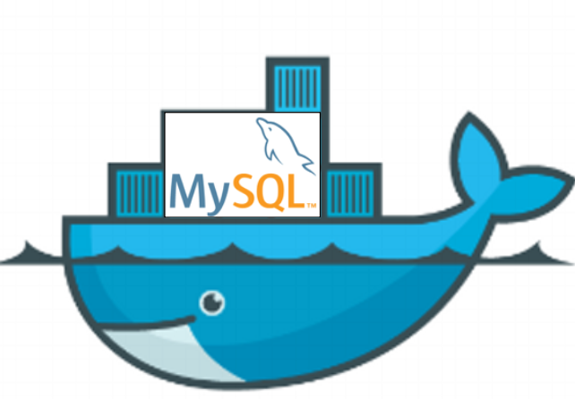

# MySQL Docker Classroom Setup

This repository contains a Dockerfile and initialization SQL script to run a MySQL database pre-populated with the Classicmodels sample dataset, plus a browser-based client (phpMyAdmin) so you can explore it without installing anything else. It is designed for teaching and experimentation.

<center></center>

## Requirements

- Docker Desktop installed (Windows, Mac, Linux)
- A web browser
- Basic knowledge of Docker commands

That's it, no separate database client is needed. (If you prefer a desktop client such as DBeaver, see [Optional: using a desktop client](#optional-using-a-desktop-client-dbeaver) below.)

## Getting Started

0. Start your Docker Desktop application

1. Clone this repository and move into its folder:
```
git clone https://github.com/captain-bender/mysql-docker-demo.git
cd mysql-docker-demo
```

2. Start the stack using Docker Compose (run this from inside the `mysql-docker-demo` folder):

```
docker compose up -d --build
```

This builds the MySQL image from the `Dockerfile`, creates a named volume for the database data, and starts two containers:
- `mysql-demo`: the MySQL server with the `classicmodels` database
- `mysql-demo-ui`: phpMyAdmin, a web interface for MySQL

> **First start takes a little while.** MySQL loads the sample database the first time it runs, which can take 30–60 seconds. phpMyAdmin waits until the database is ready before starting. You can check progress with `docker compose ps`: when `mysql-demo` shows `(healthy)` you are good to go.

3. Open phpMyAdmin in your browser:

**http://localhost:8080**

You are logged in automatically. Click `classicmodels` in the left-hand panel to see its tables.

4. Have a look at the [database schema](./MySQL-Sample-Database-Diagram-PDF-A4.pdf), then run sample queries: with `classicmodels` selected, open the **SQL** tab at the top, type a query, for example:
```
SELECT * FROM customers LIMIT 5;
```
and press **Go** (bottom right) to run it.

5. Experiment with the exercises
- Basic SQL command [here](./basic-exercises/basic_exercises.md)
- Integration with Python clients [here](./integration-exercises/integration_exercises.md)

6. If you have a lot of time, you can try that:
- Mini-projects [here](./mini-project/mini_projects.md)


The Python exercises connect directly to MySQL on `localhost:3306`, so they work alongside phpMyAdmin with no extra setup.

7. Stopping and cleaning (start from scratch)

To simply stop the containers (your data is kept), run from the `mysql-docker-demo` folder:

```
docker compose stop
```

and `docker compose start` to bring them back.

If you want to stop the stack and remove all containers, images and data so the next `up` starts from a fresh state, follow the commands below.

- Using Docker Compose: this stops services, removes containers, networks, images used by Compose, and deletes named volumes created by the compose file. WARNING: deleting volumes will permanently remove the database contents.

```
docker compose down --rmi all -v --remove-orphans
```

- What the flags do:
	- `--rmi all`: removes all images used by the services (your `classicmodels-mysql` image and the `phpmyadmin` image).
	- `-v`: removes named volumes declared in `docker-compose.yml` (this deletes DB data).
	- `--remove-orphans`: removes containers from previous runs that are not defined in this compose file.

## Optional: using a desktop client (DBeaver)

You can also connect any MySQL desktop client, such as [DBeaver](https://dbeaver.io/download/), while the stack is running. Your database type is MySQL ([figure](./images/pic2.png)), and the connection details are the following ([figure](./images/pic3.png)):
- Host: `localhost`
- Port: `3306`
- User: `root`
- Password: `passwd`
- Database: `classicmodels`

To run queries, open the SQL editor ([figure](./images/pic1.png)), write your query and press play ([figure](./images/pic4.png)).

If you get a "Public Key Retrieval is not allowed" error in DBeaver, set `allowPublicKeyRetrieval=true` in the connection properties: in the "Connection Settings" window, click the "Driver Settings" button, select the "Default properties" tab, right-click inside the table and click "Add new property" in the pop-up menu, then add the property name `allowPublicKeyRetrieval` with the value `true` ([figure](./images/pic5.png)).

## Troubleshooting

- **phpMyAdmin page doesn't load, or says it cannot connect to the server.** The database is probably still loading on first start. Wait a minute, check `docker compose ps` until `mysql-demo` shows `(healthy)`, then refresh the page.
- **"port is already allocated" when starting.** Another program is already using port `8080` or `3306` (often a locally installed MySQL). Either stop that program, or change the left-hand number in `docker-compose.yml`, e.g. `"8081:80"` and then open http://localhost:8081 instead.
- **Something seems broken and you want a clean slate.** Run the clean-up command in step 6, then `docker compose up -d --build` again.

> **Note:** The credentials in this repository (`root` / `passwd`) and phpMyAdmin's automatic login are for a local classroom setup only. Never use this configuration on a server that is reachable from a network.

## Credits
- MySQL sample database from [MySQLTutorial](https://www.mysqltutorial.org/getting-started-with-mysql/mysql-sample-database/) website.
- Web client: [phpMyAdmin](https://www.phpmyadmin.net/).
